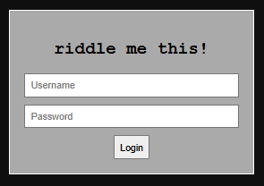
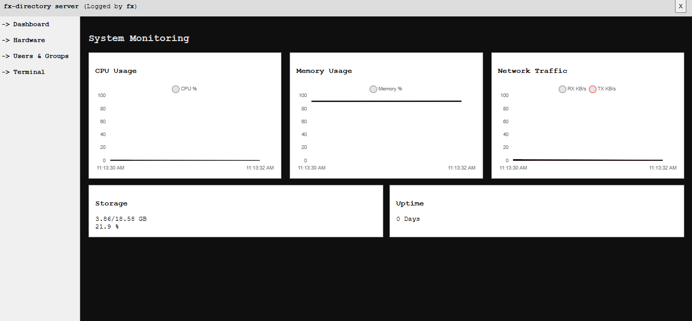
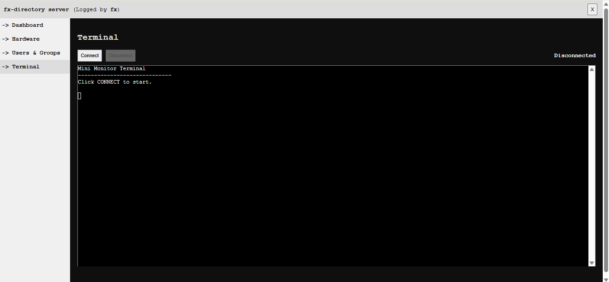

# Mini Monitor

Mini Monitor adalah aplikasi monitoring server berbasis web yang dibangun menggunakan **Python (Flask)** sebagai backend dan **HTML, CSS, JavaScript** sebagai frontend. Aplikasi ini dirancang untuk membantu administrator sistem memantau kondisi server Linux secara realtime serta menyediakan terminal berbasis web yang terintegrasi dengan autentikasi pengguna sistem operasi.

## Features

- Login menggunakan akun Linux (PAM Authentication)
- JWT Authentication
- Dashboard monitoring realtime
  - CPU Usage
  - Memory Usage
  - Network Traffic
  - Storage Usage
  - System Uptime
- Hardware Information
  - CPU Information
  - Memory Information
  - Disk Information
  - Operating System
- User & Group Management
- Web Terminal (Administrator Mode)

## Technology Stack

### Backend

- Python 3

### Frontend

- HTML5
- CSS3
- JavaScript

## System Requirements

- Linux Server (Debian 12+ recommended)
- Python 3.10+

## Installation

Clone repository

```bash
git clone https://github.com/yourusername/mini-monitor.git
cd mini-monitor
```

Create virtual environment

```bash
python3 -m venv venv
source venv/bin/activate
```

Install dependencies

```bash
pip install -r requirements.txt
```

Run application

```bash
python app.py
```

Open browser

```
http://SERVER_IP:5000
```

## Run as Systemd Service

### Create service file

Buat file service:

```bash
sudo nano /etc/systemd/system/mini-monitor.service
```

Isi file:

```ini
[Unit]
Description=Mini Monitor Service
After=network.target

[Service]
Type=simple
User=root
WorkingDirectory=/opt/mini-monitor
Environment="PATH=/opt/mini-monitor/venv/bin"
ExecStart=/opt/mini-monitor/venv/bin/python /opt/mini-monitor/app.py
Restart=always
RestartSec=5

[Install]
WantedBy=multi-user.target
```

> **Note**
>
> Sesuaikan `WorkingDirectory` dan `ExecStart` dengan lokasi instalasi project Anda.

### Reload systemd

```bash
sudo systemctl daemon-reload
```

### Enable service

```bash
sudo systemctl enable mini-monitor
```

### Start service

```bash
sudo systemctl start mini-monitor
```

### Stop service

```bash
sudo systemctl stop mini-monitor
```

### Restart service

```bash
sudo systemctl restart mini-monitor
```

### Check service status

```bash
sudo systemctl status mini-monitor
```

### View service logs

```bash
journalctl -u mini-monitor -f
```

### Disable auto start

```bash
sudo systemctl disable mini-monitor
```

## License

This project is released under the MIT License.

## Screenshots

### Login



### Dashboard



### Terminal

